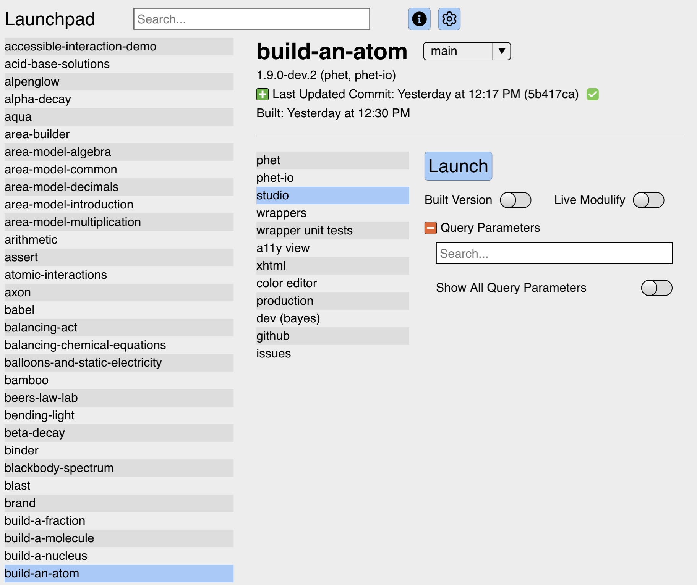
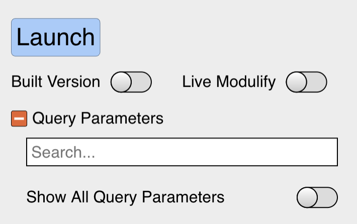
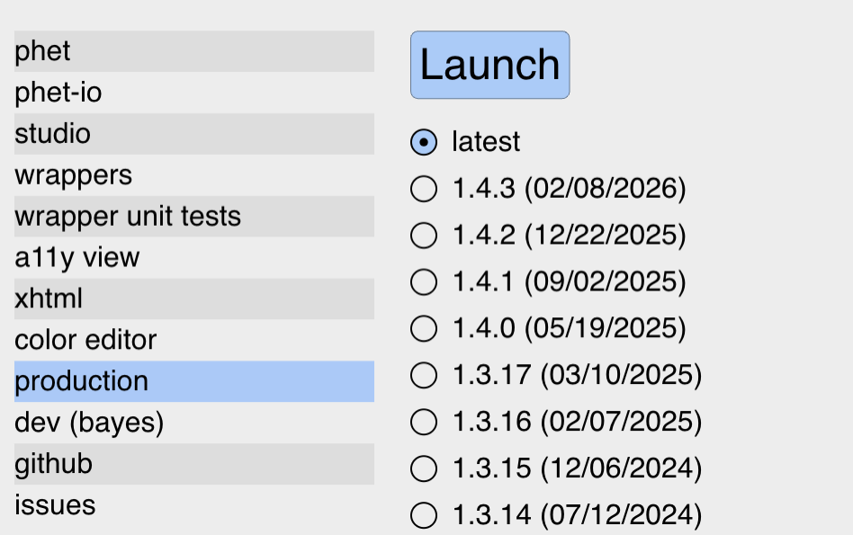
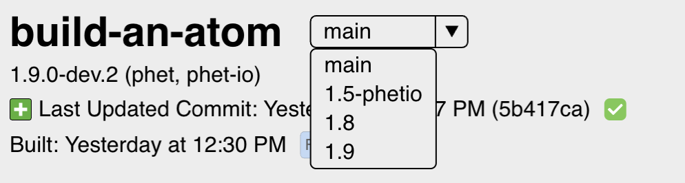
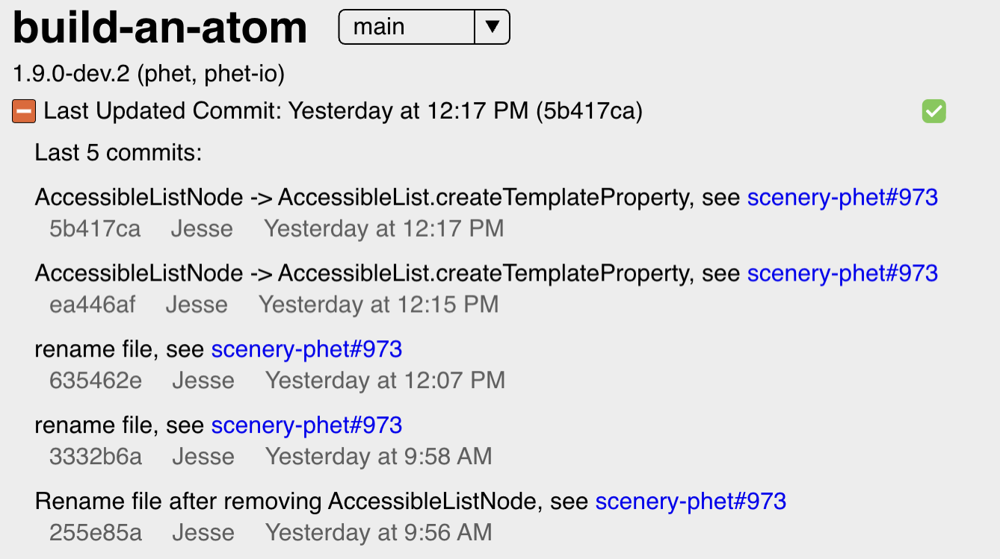
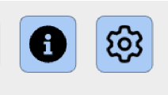
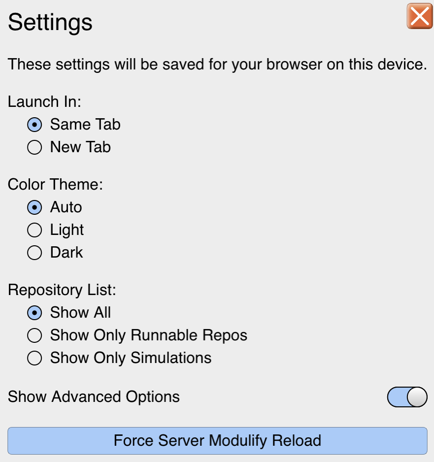
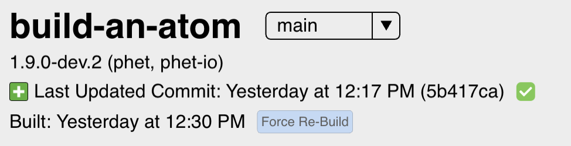
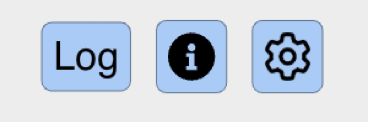

# Launchpad Documentation

## Overview / Getting Started

Launchpad is a single-screen application used to quickly launch PhET simulation configurations and accompanying applications.

Please see the [README.md](../README.md) for notes on launching (no pun intended) both the on-line and local versions.

Start by selecting your repo or simulation from the list on the left. Use the Search bar at the top to quickly narrow your selections. Entering text in the Search bar filters the available simulations or repos as you type. The Search bar supports partial and out-of-order matches, so typing parts of words will still find your intended target. For example, typing "energy skate" will find "energy-skate-park".

The Search bar is automatically focused when Launchpad loads. Begin typing to locate simulations immediately. After identifying your selection, choose the desired feature or mode in the list on the right. Modes include options like "phet", "studio", and others. Single-click to select a simulation and a mode.

To launch, press the **Launch** button or hit **Enter** at any point. Double-clicking an item or clicking an already selected item in either the simulation or mode list will also launch your selection. For runnable modules, use the branch dropdown beside the module name to choose the primary checkout, a release branch, or an addressable feature branch. Feature-branch information is loaded only after you select it.

You can modify your search to select both simulations and modes directly from the Search bar. Prefix any search term with a dash ("-") to filter modes instead of simulations. For example, entering "ball \-stu" and pressing **Enter** will select the "studio" mode for "balloons-and-static-electricity" and launch it. If you type a numeric release branch (like "1.4"), Launchpad will select that branch for the simulation, if available. While the Search bar is focused, use the arrow keys to navigate the simulation list.

## Launch Options

When available, choose whether to run the **built** or **unbuilt** version of a simulation. **Live Modulify** is available for unbuilt content on the primary checkout; it serves current generated strings and resources as you work. Release branches are build-only because their historical unbuilt toolchains may be incompatible with the current server. If a release has no build yet, build it before launching.

Also control which **query parameters** are included when launching. Expand the Query Parameter section, where you will find its own Search bar to filter parameters. Select or deselect the parameters you need. You can add multiple query parameters at once, tailoring the launch to your requirements.

For deployments, select between launching in **dev (bayes)** or **production** mode. If you need a particular deployed version, use the version dropdown shown by that mode. These deployment modes link directly to phet-dev.colorado.edu or phet.colorado.edu and are independent of the selected source branch.

## Branch and Build Information

Use the branch selector to choose the primary checkout (`main` on the hosted server), a release version, or a feature branch. Feature branches with literal underscores cannot be represented by Launchpad's URL-safe branch format and do not appear.

The latest commit and its local/remote freshness indicator are shown for the selected branch. Expand the commit section to view the last **5 commits** available in the server's local Git data. Clicking the displayed last-commit summary copies its commit URL; commit rows open the corresponding GitHub commit.

Build status is shown for runnable branches. Depending on state, the action is **Build**, **Update Build**, or **Force Re-Build**. Build output streams into the page, and reloading the page reattaches to a build that is still running. An out-of-date build means its recorded build SHA differs from the branch SHA currently known locally.

## Settings and Advanced Options

Click **Settings** to choose whether links open in the same or a new tab, select automatic/light/dark color theme, filter the module list (all, runnables, or simulations), and enable advanced options. Settings are saved in this browser on this device. Click **Info** for the concise in-app keyboard and search guide.

Advanced options include the **Log** button, force rebuilding an already current build, wrapper unit-test modes, and **Force Server Modulify Reload** in Settings.

Use **Force Re-Build** when you intentionally need a new artifact even though the recorded build SHA is current. In local developer mode, primary builds include uncommitted working-copy changes, so a force rebuild is also how to capture local changes made without advancing HEAD.

The **Log** button opens the retained warnings/errors and a live stream of server log activity. The stream reconnects automatically if the server restarts.

